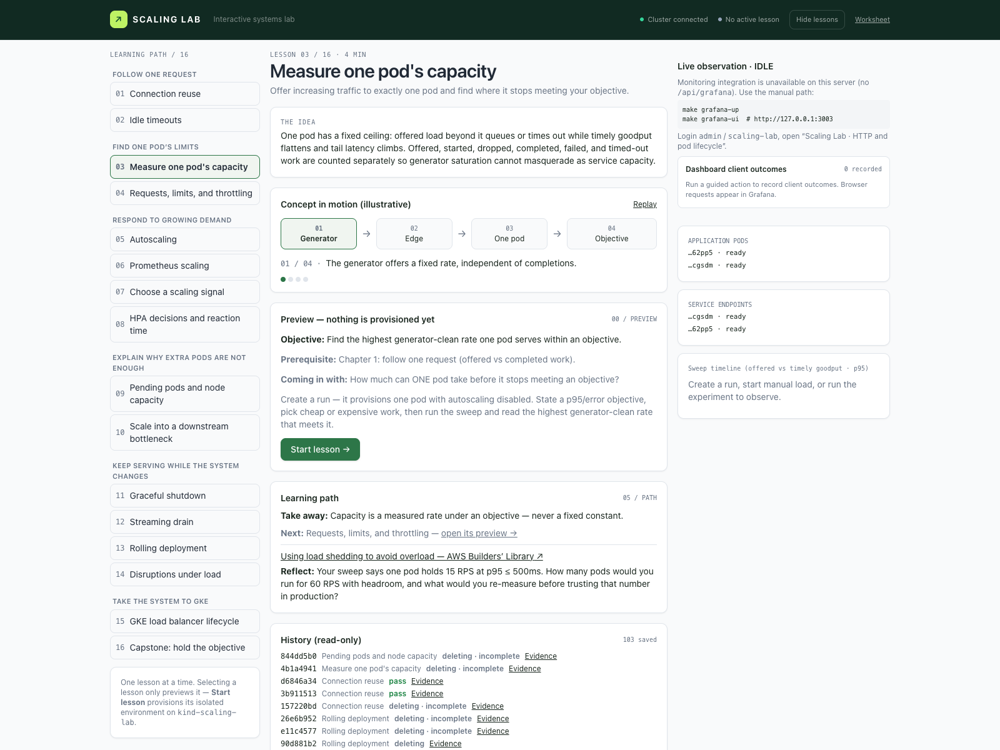
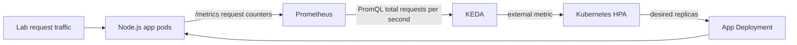

# Scaling Lab

A guided local lab that grows from one request to cloud backends: connection reuse, single-pod capacity, resource sizing, CPU and Prometheus autoscaling, scaling signals, Pending pods, downstream bottlenecks, graceful shutdown, streaming, rollouts, disruptions, the GKE load-balancer lifecycle, and a capstone. The web console (React + Tailwind) runs one lesson at a time — preview, explicit start, practice inside an isolated environment, end with saved evidence, and read-only history — paired with a live pod/endpoint view, an embedded Grafana pane, request timeline, conceptual question, and evidence-backed verification result.



Lesson preview: browse the learning path, then select **Start lesson** to prepare its environment.

## Requirements

- Docker-compatible daemon, `kind`, `kubectl`, `make`, `curl`, `helm`, and Node.js 22 or later for the Prometheus lesson
- About 4 GB free memory and network access for the first image pulls
- Port 8080 (lab proxy) and 4173 (dashboard) available on localhost

## Start

For all sixteen dashboard lessons with CPU metrics, Prometheus/KEDA, and embedded Grafana, use the full setup:

```sh
make prometheus-up  # includes make up: creates the cluster and deploys app/edge
make hpa-up         # installs metrics-server; selects CPU scaling for the shared CLI app
make grafana-up     # installs Grafana and kube-state-metrics
make ui-build       # installs dashboard deps and builds the console (dist/ is gitignored)
make dashboard     # keep this terminal running
```

The full setup leaves both autoscaling dependencies installed. The shared `scaling-lab` app ends with the CPU HPA because `hpa-up` runs last; dashboard lessons provision their own CPU HPA, KEDA scaler, or single-pod/dependency shapes in their own namespace, so all sixteen lessons remain available. For CLI Prometheus verification, run `make prometheus-up` before `make verify SCENARIO=prometheus` to select the shared Prometheus scaler again.

For lessons without autoscaling or Prometheus/Grafana monitoring, the minimal setup is:

```sh
make up
make ui-build   # one-time: installs dashboard deps and builds the console (dist/ is gitignored)
make dashboard
```

Open <http://127.0.0.1:4173>. `make up` creates a three-node kind cluster (Kubernetes v1.37.0 via kind v0.33.0, pinned image), builds the Node.js image, and deploys two app pods plus an NGINX edge proxy. `make check` confirms readiness. The console uses context `kind-scaling-lab`, shared infrastructure in `scaling-lab`, and one isolated `scaling-run-<id>` namespace for the single active lesson. The configuration worksheet lives at `/worksheet`; `make ui-dev` serves the console from source with hot reload instead.

## Learning flow (one lesson at a time)

Selecting a lesson only **previews** it — story, objective, prerequisites, duration. **Start lesson** provisions its environment in reported stages (prerequisites → environment → readiness) and reuses healthy shared infrastructure; missing pieces produce an actionable `make` command, never silent provisioning. **Practice** runs the experiment inside exactly one server-enforced environment. **End lesson** stops traffic, cancels in-progress work safely, saves evidence, and deletes only the owned namespace. Selecting another lesson while one is active asks first: cancel leaves everything untouched, confirm ends the current lesson and opens the destination preview (never auto-start). Ended lessons stay readable under **History**, even after a dashboard restart.

On a Colima VM already running several clusters, kind startup may fail if containerd reports `failed to create fsnotify watcher: too many open files`. Raise the VM's inotify instance limit, then retry `make up`:

```sh
colima ssh -- sudo sysctl -w fs.inotify.max_user_instances=1024
```

The full setup already installs the dependencies described below. If you used the minimal setup, add them as needed; the setup targets also select which scaler the shared CLI app uses.

For the autoscaling lesson, run `make hpa-up` after `make up`. This installs the pinned metrics-server release and sets `--kubelet-insecure-tls` for the local kind cluster, then creates the CPU HPA. Give metrics collection a minute before running the experiment.

For the Prometheus lesson, run `make prometheus-up`. It deploys a local Prometheus, installs KEDA 2.21.0, and creates a ScaledObject that scales the app toward **5 requests/second per pod**. This target is intentionally low for a laptop experiment; measure your own service before choosing a production target. These Make setup targets replace the scaler of the shared legacy Deployment used by CLI verification; dashboard runs each have their own Deployment and scaler. Run `make hpa-up` to restore CPU scaling for the CLI. Prometheus data is stored only in its pod and disappears if that pod is replaced.

```sh
make prometheus-up
make ui-build       # required if the console has not been built yet
make dashboard
```

To recreate the lab from scratch, save any evidence you need, stop the dashboard, run `make down`, then repeat the full setup above. `make down` deletes only the `scaling-lab` kind cluster, including its live run namespaces. Evidence already saved under `results/` remains on disk and archived evidence is rediscovered when the dashboard starts. Other kind clusters are unaffected.

In another terminal, `make prometheus-ui` optionally opens a port-forward for Prometheus at <http://127.0.0.1:19090>.

In Prometheus, inspect **Status → Target health** and query `sum(rate(scaling_lab_http_requests_total{job="scaling-app",namespace="scaling-lab"}[30s]))` for the CLI lab. For a dashboard run, replace the namespace selector with `labrun="<run-id>"`. App pods expose request/response counters at `/metrics` (`scaling_lab_http_requests_total`, `scaling_lab_http_responses_total` by method/route/status/class, a latency histogram, inflight and open-socket gauges). Prometheus scrapes each pod every five seconds, KEDA reads the query, and its generated HPA changes the Deployment replica count.

The dashboard's lesson 07 adds manual traffic controls (`steady`, `ramp`, `burst` profiles bounded for a laptop kind cluster), a predict-before-reveal step, and one synchronized cause→effect timeline: offered RPS, Prometheus observed RPS (stale samples are marked, not shown as zero), HPA desired replicas, actual replicas, and Ready replicas, with milestones for load changes, HPA decisions, pod/endpoint changes, and request failures. The one-click scenario and pass/fail verification still work, and raw evidence stays downloadable for replay.

Starting a lesson provisions its own `scaling-run-<id>` namespace (app, edge, plus a CPU HPA, KEDA scaler, single-pod shape, or isolated dependency depending on the lesson) while KEDA, Prometheus, and the dashboard stay shared. Exactly one lesson environment exists at a time — enforced by the server across tabs. Traffic is routed per lesson, Prometheus queries filter by the lesson label, and ending a lesson snapshots its evidence first; the snapshot stays downloadable afterwards, including after a dashboard restart, under **History**. The legacy `scaling-lab` namespace and `make verify` CLI paths keep working unchanged. See `docs/adr-run-isolation.md` (namespace mechanics) and `docs/adr-single-lesson.md` (lifecycle).

Selecting another lesson while one is active asks whether to end it: cancel leaves everything untouched, confirm stops traffic, saves evidence, deletes only the owned namespace, then opens the destination preview (never auto-start). A failed cleanup retains the allocation with an explicit retry instead of a second start. **Delete kind cluster** (`make down`, only the `scaling-lab` cluster) stays separate and is never part of lesson work. CLI setup targets switch the *shared* legacy namespace only: `make hpa-up` installs the CPU scaler and `make prometheus-up` installs the Prometheus/KEDA scaler there for `make verify`; dashboard lessons are independent of both.

Every ready run has an **Open app** link at `/app/<run-id>/fast`, plus browser links for an eight-second request, streaming, metrics, and readiness. These use the dashboard’s managed route to the run’s own `Service/edge`; no terminal port-forward is needed. The UI names the target namespace, and responses carry `X-Scaling-Lab-Run` and `X-Scaling-Lab-Namespace`. The legacy address `http://127.0.0.1:8080` always targets **scaling-lab**, regardless of the selected lesson. Browser app access accepts GET/HEAD only on the known learner endpoints; it never accepts arbitrary targets or credentials.

For shutdown and streaming, the monitoring pane defaults to **Requests in flight**. Use **Response counters** for short experiments or **Responses per second** for sustained traffic. Grafana’s app counters measure completed responses; a request can receive HTTP 200 headers and then fail with a connection reset while its body drains. The separate **Dashboard client outcomes** card shows such interruptions and transport failures from recorded dashboard requests. Browser-tab traffic appears in Grafana rather than the dashboard client trace.

The full setup installs Grafana and embeds it in the console; `make up` alone does not install monitoring. The Live observation card shows run-scoped request activity, completed response counters, or response rate by HTTP code (light theme, no login — anonymous Viewer, served through a dashboard-managed localhost forward; `GET /api/grafana?run=<id>`). `make grafana-up` (pins `grafana/grafana:11.3.0` plus `kube-state-metrics:v2.20.0`, local only, restarts Grafana so dashboard edits apply) provisions the **Scaling Lab · HTTP and pod lifecycle** dashboard; `make grafana-ui` (port-forward `service/grafana` to `127.0.0.1:3003`, login `admin` / `scaling-lab`) opens the full dashboard with request rate, HTTP status/error ratio, latency, active requests, sockets, scrape freshness and pod/HPA state, scoped to the active lesson. Guided controls and evidence also work when monitoring is unavailable.



```sh
make reset    # restore the baseline app configuration and remove the HPA
make test     # verifier unit tests
make ui-build # install console deps and rebuild dashboard/dist
make verify   # run the connection lesson and save evidence to results/
make down     # delete only the scaling-lab kind cluster
```

## Lessons and verification (narrative order)

| Chapter | Lesson | Experiment | Pass condition |
| --- | --- | --- | --- |
| Follow one request | Connection reuse | Eight reused and eight fresh client connections | The reused requests share an edge connection ID; fresh requests have distinct IDs |
| Follow one request | Idle timeouts | Compare one-second and 6.5-second idle gaps | The client socket remains while the ~6s Node.js upstream socket (5s keep-alive + 1s close buffer) expires |
| Find one pod's limits | Measure one pod's capacity | Sweep offered rates on one pod against a stated p95/error objective | The highest generator-clean rate meeting the objective is identified with settled accounting; thin evidence is inconclusive |
| Find one pod's limits | Requests, limits, and throttling | Vary CPU requests, then limits, then memory at constant traffic | Utilization follows the request denominator; cpu.stat proves throttling; a restart plus OOMKilled proves the memory demo |
| Respond to growing demand | Autoscaling | Sustain CPU-intensive requests, then stop the load | The HPA adds replicas, returns to baseline, and sampled scale-down requests succeed |
| Respond to growing demand | Prometheus scaling | Sustain HTTP requests, then reduce the rate | Prometheus scrapes all starting pods, observes over 10 requests/second, the KEDA HPA adds replicas and returns to baseline, and sampled requests succeed |
| Respond to growing demand | Choose a scaling signal | Compare CPU burn with slow I/O at equal RPS, plus a backlog-driven queue | Hottest-pod burn separates the workloads; workers scale from real backlog |
| Respond to growing demand | HPA decisions and reaction time | Predict desired replicas through burst, gated rollout, and recovery | Scale-out lag, rollout-gate lag, exact probe restore, and stabilization are all evidenced |
| Explain why extra pods are not enough | Pending pods and node capacity | Constrain scheduling so pods stay Pending, then restore | Pending pods carry scheduler reasons with distinguished counts; the run recovers (kind never autoscales nodes) |
| Explain why extra pods are not enough | Scale into a downstream bottleneck | Push 4 callers at a 1-pod dependency under aggressive vs strict retry policies | Dependency saturation is measured on the dependency; the verdict compares timely success honestly either way |
| Keep serving while the system changes | Graceful shutdown (+abrupt comparison) | Delete the pod serving an eight-second request | That request finishes and sampled background requests have no failures (abrupt mode interrupts it instead) |
| Keep serving while the system changes | Streaming drain | Delete a pod during a 20-tick response | The stream completes with all 20 ticks |
| Keep serving while the system changes | Rolling deployment | Change a pod-template environment variable under traffic | A new pod serves traffic and sampled requests have no failures |
| Keep serving while the system changes | Disruptions under load | Ordered evictions, direct delete, and rollout under a PDB | First eviction allowed, second refused with budget evidence, delete bypasses, traffic categorized |
| Take the system to GKE | GKE load balancer lifecycle | Correlate endpoint removal with response completion under drain | All three timestamps recorded with an explicit ordering verdict (local backend-drain analogue; GKE steps pending configuration) |
| Take the system to GKE | Capstone: hold the objective | Hold a stated objective through burst, rollout, and guarded disruption | Every phase meets the objective with an allowed eviction; replica growth alone never passes |

Checks may return **inconclusive** if the intended race or enough traffic was not observed. The result includes raw request and pod evidence. A passing local experiment is evidence for this topology and workload, not a guarantee for a different ingress, service mesh, or cloud load balancer.

Predictions and explanations are saved with an experiment attempt, separately
from its verifier result. Use **Prepare next attempt** before making a new
prediction after an experiment. Rerunning also retains the previous attempt;
earlier results, explanations, and the initial explanation revision remain
in the evidence export. Submitted learning records survive a dashboard
restart through atomic local snapshots. Unsaved text is a browser draft.

The capstone console requires a rationale for its replica bounds and CPU
target. `make verify SCENARIO=capstone` uses an explicit baseline rationale
with the default settings; set `SCALING_LAB_CAPSTONE_RATIONALE` to supply your
own rationale for that CLI baseline. This is recorded in its evidence.

You can run most lessons without the browser using `make verify SCENARIO=shutdown MODE=graceful` (any of the sixteen IDs except `downstream`, which needs its dashboard-provisioned dependency). The command writes a JSON evidence report under `results/` and exits nonzero for a failed or inconclusive check. Run the relevant setup target before either autoscaling verifier (`make hpa-up` for CPU lessons, `make prometheus-up` for the Prometheus lesson).

Use the dashboard's **configuration worksheet** after the lessons. It checks shutdown timing and compares measured per-pod capacity with peak demand and HPA replica limits. It exports a JSON record of your choices. The worksheet is a consistency check; rerun live experiments with the actual settings before applying them elsewhere.

## What to observe

The edge proxy exposes `X-Edge-Connection`; the app exposes `X-App-Connection`, `X-Pod`, and `X-Request-Id`. Client and upstream connection IDs represent different connection pools. The proxy disables response buffering so the shutdown runner can identify and delete the serving pod while its response is still active. The app logs JSON events for connection opening/closing, request start/end, and shutdown. Use `kubectl --context kind-scaling-lab -n scaling-lab logs deployment/app --all-pods=true --prefix=true` to inspect them.

The app is configured with a two-second `preStop`, a 30-second pod grace period, and a 24-second app shutdown deadline. These are experiment values, not universal production settings. The `preStop` duration is part of the pod's grace period. The app uses Node.js 24's `server.close()` behavior for idle and active HTTP/1.1 connections. Streaming is available at `/stream` for manual exploration; upgraded WebSocket connections need separate handling in a real app.

## Project layout

```text
app/          Instrumented Node.js service and Dockerfile
dashboard/    Console (React source in ui/, built assets in dist/), scenario runner, and verifier
dashboard/ui/ React + Tailwind console source (Vite; needs make ui-build once)
k8s/          kind, app, proxy, Prometheus, scaler, Grafana, and GKE continuation manifests
scripts/      Browser acceptance, guarded node-drain, and GKE artifact validation
Makefile      Setup, reset, test, and teardown commands
```

## Pinned versions (verified 2026-10-11/12 against official releases)

- kind CLI v0.33.0; cluster Kubernetes v1.37.0 (`kindest/node:v1.37.0@sha256:a1ed…580ae5`); kubectl client v1.37.1
- metrics-server v0.9.0 (documented 1.34+ line); KEDA 2.21.0 (tested through 1.36, latest stable); kube-state-metrics v2.20.0
- Prometheus v3.5.0 and Grafana 11.3.0 kept (no incompatibility found; functionally verified)

## GKE continuation

`k8s/gke/` holds Gateway/HTTPRoute/health-check/backend-policy manifests, a VPA recommender, an impossible-constraint demo, and a node-pool runbook. They are validated locally only (`node scripts/gke-validate.mjs`); **cloud execution is pending explicit project configuration** and is documented in [docs/gke-continuation.md](docs/gke-continuation.md). No lab command provisions cloud resources.

The console at `/` is built output (`dashboard/dist/`, gitignored — run `make ui-build` after a fresh clone); `/worksheet` keeps its classic page. The dashboard binds to `127.0.0.1` and exposes only predefined scenarios against the dedicated lab context. It does not accept arbitrary shell commands. The managed `GET /api/grafana` route forwards only the provisioned Grafana service over an ephemeral localhost port.

Live acceptance steps are in [docs/kind-acceptance.md](docs/kind-acceptance.md); the lifecycle contract is in [docs/adr-single-lesson.md](docs/adr-single-lesson.md); GKE continuations are in [docs/gke-continuation.md](docs/gke-continuation.md).

## Reference documentation

- [Node.js HTTP server connection and shutdown behavior](https://nodejs.org/api/http.html)
- [Kubernetes pod and endpoint termination flow](https://kubernetes.io/docs/tutorials/services/pods-and-endpoint-termination-flow/)
- [Kubernetes container lifecycle hooks](https://kubernetes.io/docs/concepts/containers/container-lifecycle-hooks/)
- [Kubernetes HPA behavior](https://kubernetes.io/docs/concepts/workloads/autoscaling/horizontal-pod-autoscale/)
- [Prometheus scrape configuration](https://prometheus.io/docs/prometheus/latest/configuration/configuration/)
- [KEDA Prometheus scaler](https://keda.sh/docs/2.21/scalers/prometheus/)
- [KEDA ScaledObject behavior](https://keda.sh/docs/2.21/reference/scaledobject-spec/)
- [kind cluster configuration](https://kind.sigs.k8s.io/docs/user/configuration/)
