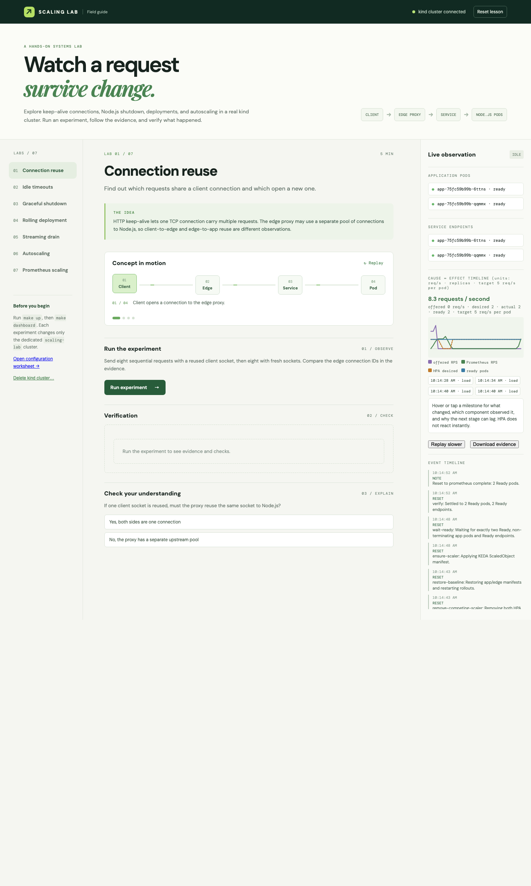
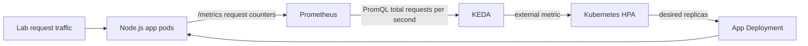

# Scaling Lab

A guided local lab for HTTP connection reuse, Node.js graceful shutdown, Kubernetes rollouts, CPU autoscaling, and Prometheus request-rate autoscaling. The web dashboard pairs each experiment with a live pod/endpoint view, request timeline, conceptual question, and evidence-backed verification result.



## Requirements

- Docker-compatible daemon, `kind`, `kubectl`, `make`, `curl`, `helm`, and Node.js 22 or later for the Prometheus lesson
- About 4 GB free memory and network access for the first image pulls
- Port 8080 (lab proxy) and 4173 (dashboard) available on localhost

## Start

```sh
make up
make dashboard
```

Startup includes Prometheus, kube-state-metrics and a provisioned Grafana
dashboard. In **Live observation**, click **Expand** for a wider timeline and
request trace, or **Open dashboard for this run** for HTTP codes/error ratio,
latency, active requests, connections and pod/HPA metrics. The embedded Grafana
panel follows the selected run and switches to an absolute time range on
pause/scrub. Collapse or Escape restores the layout without changing the run.

### Regression checks

```sh
make test               # unit/API/grader checks; no cluster needed
make test-kind-smoke    # fresh cluster: startup, Grafana, HTTP metrics, isolation
make test-kind          # fresh cluster: all seven lessons, both shutdown modes
node scripts/kind-cleanup-check.mjs  # real failure + SIGTERM cleanup proof
```

These commands allocate only a new `scaling-lab-test-*` cluster, use a private
kubeconfig and free ports, save evidence in `results/`, and delete their cluster
on success/failure/interruption. They preserve existing learner clusters.
The full gate also runs automatically in GitHub Actions for relevant changes.
For a laptop already hosting other clusters, `KIND_TEST_WORKERS=0 make test-kind`
uses one node; CI uses the normal three-node topology. See
[kind acceptance](docs/kind-acceptance.md) for prerequisites and evidence.

Open <http://127.0.0.1:4173>. `make up` creates a three-node kind cluster, builds the Node.js image, and deploys two app pods plus an NGINX edge proxy. `make check` confirms readiness. The dashboard uses context `kind-scaling-lab`, shared infrastructure in `scaling-lab`, and a separate `scaling-run-<id>` namespace for each experiment.

On a Colima VM already running several clusters, kind startup may fail if containerd reports `failed to create fsnotify watcher: too many open files`. Raise the VM's inotify instance limit, then retry `make up`:

```sh
colima ssh -- sudo sysctl -w fs.inotify.max_user_instances=1024
```

For the autoscaling lesson, run `make hpa-up` first. This installs the pinned metrics-server release and sets `--kubelet-insecure-tls` for the local kind cluster, then creates the CPU HPA. Give metrics collection a minute before running the experiment.

For the Prometheus lesson, run `make prometheus-up`. It deploys a local Prometheus, installs KEDA 2.17.3, and creates a ScaledObject that scales the app toward **5 requests/second per pod**. This target is intentionally low for a laptop experiment; measure your own service before choosing a production target. These Make setup targets replace the scaler of the shared legacy Deployment used by CLI verification; dashboard runs each have their own Deployment and scaler. Run `make hpa-up` to restore CPU scaling for the CLI. Prometheus data is stored only in its pod and disappears if that pod is replaced.

```sh
make prometheus-up
make dashboard
```

In another terminal, `make prometheus-ui` optionally opens a port-forward for Prometheus at <http://127.0.0.1:19090>.

In Prometheus, inspect **Status → Target health** and query `sum(rate(scaling_lab_http_requests_total{job="scaling-app",namespace="scaling-lab"}[30s]))` for the CLI lab. For a dashboard run, replace the namespace selector with `labrun="<run-id>"`. App pods expose the counter at `/metrics`. Prometheus scrapes each pod every five seconds, KEDA reads the query, and its generated HPA changes the Deployment replica count.

The dashboard's lesson 07 adds manual traffic controls (`steady`, `ramp`, `burst` profiles bounded for a laptop kind cluster), a predict-before-reveal step, and one synchronized cause→effect timeline: offered RPS, Prometheus observed RPS (stale samples are marked, not shown as zero), HPA desired replicas, actual replicas, and Ready replicas, with milestones for load changes, HPA decisions, pod/endpoint changes, and request failures. The one-click scenario and pass/fail verification still work, and raw evidence stays downloadable for replay.

Prometheus experiments run isolated: creating a run provisions its own `scaling-run-<id>` namespace (app, edge, KEDA scaler) while KEDA, Prometheus, and the dashboard stay shared. The same isolation now covers all seven lessons — each lesson runs one-click scenarios inside its own namespace (autoscaling lessons add their own HPA), with per-lesson traffic routing and evidence. Traffic is routed per run, Prometheus queries filter by the run label, and at most two runs are active (laptop limit). Cleaning up a run snapshots its evidence first; the snapshot stays downloadable afterwards, including after a dashboard restart. The legacy `scaling-lab` namespace and `make verify` CLI paths keep working unchanged. See `docs/adr-run-isolation.md`.

Use **New run** in the top bar to provision a fresh isolated run for the current lesson. Opening another lesson or creating runs never mutates other runs; each run keeps its own namespace, traffic route, graph, and evidence. Cleaning up a run (with its own confirmation naming the namespace and effects) snapshots evidence first, which stays downloadable afterwards. **Delete kind cluster** (`make down`, only the `scaling-lab` cluster) stays separate and is never part of lesson work. CLI setup targets switch the *shared* legacy namespace only: `make hpa-up` installs the CPU scaler and `make prometheus-up` installs the Prometheus/KEDA scaler there for `make verify`; dashboard runs are independent of both.

Grafana is installed by default; guided controls and evidence also work when monitoring is unavailable. After the built-in timeline, try `make grafana-up` (pins `grafana/grafana:11.3.0` plus `kube-state-metrics:v2.12.0`, local only) and `make grafana-ui` (port-forward `service/grafana` to `127.0.0.1:3003`, login `admin` / `scaling-lab`). The provisioned **Scaling Lab - request rate vs replicas** dashboard shows request rate, scrape targets, HPA desired/current replicas, Ready pods, and how to compare with the guided UI.



```sh
make reset    # restore the baseline app configuration and remove the HPA
make test     # verifier unit tests
make verify   # run the connection lesson and save evidence to results/
make down     # delete only the scaling-lab kind cluster
```

## Lessons and verification

| Lesson | Experiment | Pass condition |
| --- | --- | --- |
| Connection reuse | Eight reused and eight fresh client connections | The reused requests share an edge connection ID; fresh requests have distinct IDs |
| Idle timeouts | Compare one-second and 6.5-second idle gaps | The client socket remains while the ~6s Node.js upstream socket (5s keep-alive + 1s close buffer) expires |
| Graceful shutdown | Delete the pod serving an eight-second request | That request finishes and sampled background requests have no failures |
| Abrupt exit | Repeat shutdown with `SHUTDOWN_MODE=abrupt` | The targeted long request is interrupted, demonstrating the failure |
| Rolling deployment | Change a pod-template environment variable under traffic | A new pod serves traffic and sampled requests have no failures |
| Streaming drain | Delete a pod during a 20-tick response | The stream completes with all 20 ticks |
| Autoscaling | Sustain CPU-intensive requests, then stop the load | The HPA adds replicas, returns to baseline, and sampled scale-down requests succeed |
| Prometheus scaling | Sustain HTTP requests, then reduce the rate | Prometheus scrapes both starting pods, observes over 10 requests/second, the KEDA HPA adds replicas and returns to baseline, and sampled requests succeed |

Checks may return **inconclusive** if the intended race or enough traffic was not observed. The result includes raw request and pod evidence. A passing local experiment is evidence for this topology and workload, not a guarantee for a different ingress, service mesh, or cloud load balancer.

You can run any lesson without the browser using `make verify SCENARIO=shutdown MODE=graceful` (or `connections`, `timeouts`, `rollout`, `streaming`, `autoscale`, `prometheus`). The command writes a JSON evidence report under `results/` and exits nonzero for a failed or inconclusive check. Run the relevant setup target before either autoscaling verifier.

Use the dashboard's **configuration worksheet** after the lessons. It checks shutdown timing and compares measured per-pod capacity with peak demand and HPA replica limits. It exports a JSON record of your choices. The worksheet is a consistency check; rerun live experiments with the actual settings before applying them elsewhere.

## What to observe

The edge proxy exposes `X-Edge-Connection`; the app exposes `X-App-Connection`, `X-Pod`, and `X-Request-Id`. Client and upstream connection IDs represent different connection pools. The proxy disables response buffering so the shutdown runner can identify and delete the serving pod while its response is still active. The app logs JSON events for connection opening/closing, request start/end, and shutdown. Use `kubectl --context kind-scaling-lab -n scaling-lab logs deployment/app --all-pods=true --prefix=true` to inspect them.

The app is configured with a two-second `preStop`, a 30-second pod grace period, and a 24-second app shutdown deadline. These are experiment values, not universal production settings. The `preStop` duration is part of the pod's grace period. The app uses Node.js 24's `server.close()` behavior for idle and active HTTP/1.1 connections. Streaming is available at `/stream` for manual exploration; upgraded WebSocket connections need separate handling in a real app.

## Project layout

```text
app/          Instrumented Node.js service and Dockerfile
dashboard/    Guided UI, scenario runner, and verifier
k8s/          kind, app, proxy, Prometheus, and scaler manifests
Makefile      Setup, reset, test, and teardown commands
```

The dashboard binds to `127.0.0.1` and exposes only predefined scenarios against the dedicated lab context. It does not accept arbitrary shell commands.

The next implementation checklist, including kind access and live acceptance steps, is in [docs/opencode-handoff.md](docs/opencode-handoff.md).

## Reference documentation

- [Node.js HTTP server connection and shutdown behavior](https://nodejs.org/api/http.html)
- [Kubernetes pod and endpoint termination flow](https://kubernetes.io/docs/tutorials/services/pods-and-endpoint-termination-flow/)
- [Kubernetes container lifecycle hooks](https://kubernetes.io/docs/concepts/containers/container-lifecycle-hooks/)
- [Kubernetes HPA behavior](https://kubernetes.io/docs/concepts/workloads/autoscaling/horizontal-pod-autoscale/)
- [Prometheus scrape configuration](https://prometheus.io/docs/prometheus/latest/configuration/configuration/)
- [KEDA Prometheus scaler](https://keda.sh/docs/2.17/scalers/prometheus/)
- [KEDA ScaledObject behavior](https://keda.sh/docs/2.17/reference/scaledobject-spec/)
- [kind cluster configuration](https://kind.sigs.k8s.io/docs/user/configuration/)
